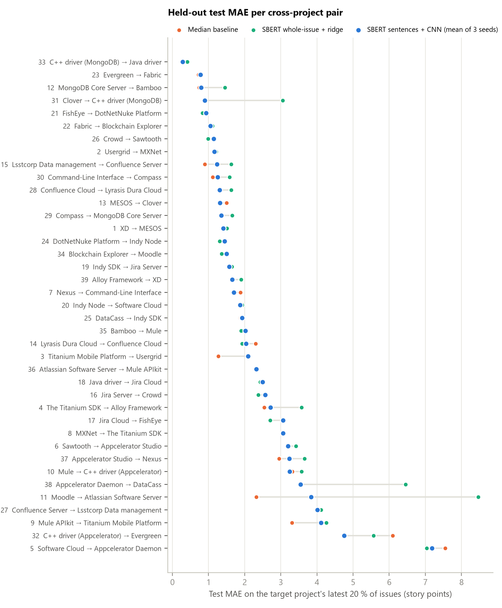

# PS-8 · SBERT Sentence Embeddings for Cross-Project, Chronologically Ordered Story Point Estimation

**Course project – Natural Language Processing · Group 1 · Problem statement 8**

> *Evaluate SBERT-based sentence embeddings for predicting story points of later issues in a target project using chronological ordering.*

| Setting | Value |
|---|---|
| Text representation | Sentence embeddings (SBERT, `sentence-transformers/all-mpnet-base-v2`) |
| Project setting | Cross-project (39 assigned source → target pairs) |
| Data splitting | Temporal / chronological ordering |
| Prediction model | Three-layer 1-D CNN over the sequence of SBERT sentence embeddings |
| Metrics | Mean Absolute Error (MAE), Median Absolute Error (MdAE) |
| Dataset | TAWOS — <https://doi.org/10.5522/04/21308124> |

## Group members

| # | Name | Roll number |
|---|---|---|
| 1 | Amal Faris M | B230162CS |
| 2 | Richie James | B230519CS |
| 3 | Vedavyas S Poika | B230607CS |
| 4 | Muhammed Ismayil | B230434CS |
| 5 | Janardhan Abhiram Bojja | B230979CS |

📄 **Final report:** [`report/PS8_Group1_Report.pdf`](report/PS8_Group1_Report.pdf) ·
📘 **Study guide** (concepts, code walkthrough, likely questions): [`report/Study_Guide.md`](report/Study_Guide.md)
([PDF](report/PS8_Study_Guide.pdf))

## Results at a glance

Held-out test = the **latest 20 % of each target project**; validation = chronological 5-fold CV on the **source**
project. Mean over the 39 assigned pairs (pooled = all 10,354 test issues together). CNN test values are averaged over 3
seeds.

| Representation | Model configuration | 5-fold val MAE | 5-fold val MdAE | **Test MAE** | **Test MdAE** | Test MAE (pooled) | Test MdAE (pooled) |
|---|---|---|---|---|---|---|---|
| **SBERT sentence embeddings** | all-mpnet-base-v2 (frozen) per sentence → 3-layer 1-D CNN, L1 loss; lr/dropout tuned per pair | 1.82 ± 1.52 | 1.19 ± 0.83 | **2.21** | **1.85** | **3.00** | **1.80** |
| SBERT whole-issue vector (reference) | same encoder, one vector per issue → ridge | 2.09 ± 1.90 | – | 2.56 | 2.13 | 3.19 | 1.86 |
| No text (baseline) | median story point of the source project | – | – | 2.16 | 1.88 | 3.11 | 2.00 |
| No text (baseline) | mean story point of the source project | – | – | 2.56 | 2.19 | 3.19 | 1.91 |

**Findings**

* SBERT + CNN is **statistically on par with the source-median baseline** (MAE 2.21 vs 2.16, Wilcoxon p = 0.59,
  negligible effect). It has the **lowest MdAE** and the **lowest pooled MAE** of all predictors, and is
  **significantly better than a linear model on whole-issue SBERT vectors** (p = 0.014).
* Inside the source project the CNN *does* beat the median baseline (34/39 pairs, −7 % MAE), but on the target project
  that advantage is gone (−4.4 % on average). What it learns about effort is project-specific.
* The difference in **story-point scale** between source and target explains most of the error (r = 0.76 between the
  |median SP difference| and test MAE). Semantic similarity between projects does not predict transfer (r = −0.19).
* The text still carries a weak **ranking** signal: median Spearman ρ = 0.10, significant in 12/39 pairs.
* Robustness: forward-chaining validation (always validating on the future) gives the same picture (1.76 vs 1.82
  validation MAE). **Strict cross-project chronology** (source issues created before the target test window only;
  feasible for 29 pairs) again puts the CNN on par with the median baseline (2.42 vs 2.42).

Full tables: [`results/main/tables/`](results/main/tables) · figures: [`results/main/figures/`](results/main/figures) ·
per-pair JSON: [`results/main/pair_results.json`](results/main/pair_results.json) · per-issue predictions:
[`results/main/test_predictions.csv`](results/main/test_predictions.csv) · exact partitions:
[`results/splits/`](results/splits).



## Discussion (guideline §3.4)

Full version: sections 6–7 of the [report](report/PS8_Group1_Report.pdf).

### Which representation achieves the lowest MAE and MdAE?

Our assignment covers the SBERT representation. We therefore compare two ways of using SBERT against the text-free
baselines, all on identical partitions.

* **Lowest MdAE: SBERT sentence embeddings + CNN** — 1.85 averaged over pairs, 1.80 pooled.
* **Lowest pooled MAE: SBERT sentence embeddings + CNN** — 3.00 vs 3.11 for the median baseline.
* **Lowest MAE averaged over pairs: the median baseline**, marginally — 2.16 vs 2.21 for the CNN. The difference is
  not significant (Wilcoxon p = 0.59, A12 = 0.52, negligible).
* Treating an issue as a **sequence of sentence embeddings** (CNN) beats one SBERT vector per issue with a linear model
  (MAE 2.21 vs 2.56, p = 0.014).

The exported partitions ([`results/splits/`](results/splits)) and per-issue predictions let the BERT (PS-4) and
combined-embedding (PS-12) groups make a paired comparison on the same test issues.

### Possible explanations for the observed results

1. **Story points are a project-relative unit.** Each team calibrates its own scale. The difference between the
   source and target median story point correlates with test MAE at r = 0.76. A model trained where “typical” is 3
   points keeps predicting about 3 on a project where typical is 8 (Software Cloud → Appcelerator Daemon, MAE 7.18).
2. **The effort signal the CNN learns is project-specific.** On the source's own validation folds the CNN beats the
   median baseline in 34 of 39 pairs (−7 % MAE). On the target's later issues that advantage disappears (−4.4 %
   relative change, paired p = 4.5e-07).
3. **The text–effort signal is weak, so the L1-trained CNN falls back to the median.** In 19 pairs its predictions
   barely vary (std < 0.25 points). There is still a weak ordering signal: median Spearman ρ = 0.10, significant in 12
   pairs.
4. **The encoder is frozen and general-purpose.** all-mpnet-base-v2 encodes topic and semantic similarity, not effort.
   Semantically similar source/target projects do not transfer better (r = −0.19), and same-repository pairs are no
   better than the others.
5. **Concept drift.** Test issues are the newest ones, and estimation practice changes over time.
6. **When the text does help, the gain is large.** Aptana Studio → Evergreen: MAE 4.75 vs 6.10 for the median baseline.

### Limitations and threats to validity

* **Construct validity.**
  * Story points are subjective and project-relative, so MAE in “points” is not comparable across scales. We report
    per-pair values next to pooled ones.
  * 12 % of TAWOS issues had their points changed after estimation; we predict the final value.
  * Our filters (completed work only, 0 < SP ≤ 100) change the population. They are applied identically to all pairs.
* **Internal validity.**
  * The hyper-parameter grid is small (4 configurations).
  * Early stopping on the validation fold makes validation estimates slightly optimistic; the test set is unaffected.
  * Blocked folds 1–4 train on later source issues. The forward-chaining check gives similar estimates (1.76 vs 1.82).
  * Seed variance is small: test-MAE std over 3 seeds is 0.05 on average.
  * The “C++ driver (Appcelerator)” → Aptana Studio mapping is an assumption.
* **External validity.**
  * 39 fixed pairs from open-source Jira projects with English text, one source per target.
  * Some test sets are small (as few as 21 issues), so those pairs are noisy.
  * Industrial projects, multi-source training or other encoders may behave differently.
* **Conclusion validity.**
  * Non-parametric paired tests over 39 pairs, with effect sizes.
  * No multiple-comparison correction; with Bonferroni over the six tests nothing is significant, so we claim only
    parity with the median baseline.
* **Protocol.** Strict cross-project chronology (training only on source issues older than the target test window) is
  impossible for 10 of the 39 assigned pairs. It is reported as a sensitivity analysis on the 29 feasible pairs, where
  the conclusion is unchanged.

## Problem statement and objectives

Agile teams assign **story points** to issues to express their relative effort. We investigate whether the
*meaning of the issue text*, captured by **SBERT sentence embeddings**, lets a model trained on one software
project (the **source**) estimate the story points of the **most recent issues of a different project** (the
**target**), when all data are ordered **chronologically**.

Objectives

1. Represent every issue as a sequence of SBERT sentence embeddings (title + description sentences).
2. Train a three-layer CNN regressor on a source project and evaluate it on the later issues of the target project,
   for all 39 source → target pairs assigned in the project guidelines.
3. Select hyper-parameters with chronological five-fold validation on development (source) data only, and
   evaluate the selected model once on the held-out test set.
4. Report MAE and MdAE for validation (mean ± std over folds) and for the held-out test, compare against
   reference predictors, and discuss limitations and threats to validity.

## Dataset

**TAWOS** (Tawosi, Al-Subaihin, Moussa & Sarro, MSR 2022) — Jira issues of agile open-source projects, distributed
as a MySQL dump (`TAWOS.sql.zip`, 637 MB, 4.3 GB uncompressed). The current release contains 39 projects from 12
organisations (Apache, Atlassian, MongoDB, Hyperledger, …), all with story points — exactly the 39 projects of the
guideline's pair list.

`scripts/download_tawos.py` downloads the dump (parallel range requests, MD5-verified) and
`src/extract_tawos.py` streams it straight out of the zip — **no MySQL server is needed** — keeping the
`Issue`, `Project` and `Repository` tables.

### Filtering (`src/preprocess.py`, numbers in `results/data_filtering.csv`)

| Step | Issues |
|---|---:|
| TAWOS issues with a story point (39 projects) | 65,427 |
| completed work (resolution Fixed/Done/Complete/…, or Done/Closed status when no resolution was recorded) | 53,901 |
| 0 < story point ≤ 100 (removes zeros and data-entry outliers such as 26,710,114 or 6,765) | 51,992 |
| non-empty title, exact duplicates removed | **51,777** |

Text = **title + natural-language description** (TAWOS `Description_Text`, where code blocks are already
removed). URLs, user mentions and Jira markup are normalised, and the description is split into sentences at line
breaks and sentence-final punctuation. Per-project statistics are in `results/data_summary.csv`.

### Project-name mapping

The guideline names were mapped to TAWOS projects in `configs/project_map.csv`. 38 names match directly.
**Assumption:** the guideline's *"C++ driver (Appcelerator)"* has no literal TAWOS counterpart; the only TAWOS
project not claimed by any other name is **Aptana Studio (APSTUD)**, which belongs to the Appcelerator repository,
so it is used for that name. The 39 pairs are listed verbatim in `configs/pairs.csv` — every project is a source
exactly once and a target exactly once.

## Method

### SBERT sentence representation (`src/embed_sbert.py`)

* Model: `sentence-transformers/all-mpnet-base-v2` (768-d, mean pooling), **frozen** — used as a feature extractor.
* Each issue → sequence `[title, s1, s2, …]` of at most **24 sentences** (covers 97.1 % of issues; median 4).
  Every sentence is encoded independently; identical sentences are encoded once (248,947 unique of 305,403).
* The result is a matrix `X ∈ R^{24×768}` per issue plus a padding mask, cached as float16 in
  `data/embeddings/<PROJECT>.npz`.
* For the reference model we also store one SBERT vector of the whole issue text (truncated at 384 tokens).

### Three-layer CNN (`src/model.py`)

```
input  (24 sentences × 768)            mask marks real sentences
Conv1d 768→256, k=3, ReLU, dropout
Conv1d 256→128, k=3, ReLU, dropout
Conv1d 128→64,  k=3, ReLU
masked global max-pool ‖ masked global mean-pool  → 128
Linear 128→64, ReLU, dropout → Linear 64→1        → story points
```

The convolution slides over *consecutive sentences*, so each filter sees a 3-sentence window. 721,473 trainable
parameters. Loss = L1 (directly optimises MAE), AdamW, batch 64, gradient clipping 1.0, output bias initialised to
the median training story point, predictions clipped at 0.

### Data splitting — cross-project + chronological (`src/splits.py`)

```
target project  ──sorted by creation date──►  [ earlier 80 % : unused ][ latest 20 % : TEST ]
source project  ──sorted by creation date──►  [ F1 | F2 | F3 | F4 | F5 ]  development data
```

* **Test set** = the most recent 20 % of the target project's issues ("later issues in a target project"). It is
  never used for training, early stopping or model selection. Because it is the same chronological 80:20 cut as
  the within-project temporal problem statements use, results are directly comparable with theirs.
* The earlier 80 % of the target is not used at all, keeping the setting strictly cross-project.
* **Development set** = the source project, sorted by creation date and cut into **five contiguous chronological
  folds** (no shuffling). In each of five runs, four folds train and one fold validates; every fold is the
  validation fold once (guideline 3.2). Early stopping (patience 8, max 60 epochs) watches the validation fold.
* **Model selection**: the grid configuration with the lowest mean validation MAE is selected; the final model
  is refit on all development data for the median best epoch of the five folds, with seeds 42, 43 and 44, and
  evaluated once on the test set (we report mean ± std over the three seeds).
* **Forward-chaining check**: in blocked folds 1–4 the training data include issues *later* than the validation
  fold. To show the selection is not an artefact of that, the selected configuration is also validated with
  forward-chaining folds (six chronological blocks; run *k* trains on blocks 1…k and validates on block k+1), so
  every validation issue is strictly later than all training issues. Reported only, never used for selection.
* **Strict cross-project chronology (sensitivity run)**: the main protocol orders each project by its own
  timeline. We also re-ran every pair keeping only source issues created *before* the target's first test issue.
  This is feasible for only 29 of the 39 pairs — in the other 10 the source project starts after the target's
  test window (e.g. Sawtooth → Appcelerator Studio has 0 such issues).

### Reference predictors (same development data, same test sets)

* **Median** and **Mean** of the source project's story points (standard naive baselines in effort estimation).
* **SBERT whole-issue vector + ridge regression** (alpha chosen by the same chronological CV) — tells us
  whether the sentence-sequence CNN adds anything over a linear model on the same SBERT model.

### Hyper-parameters (`configs/config.yaml`)

| Parameter | Value |
|---|---|
| Grid (selected per pair by 5-fold validation MAE) | learning rate ∈ {1e-3, 3e-4} × dropout ∈ {0.2, 0.5} |
| Fixed | channels (256, 128, 64), kernel 3, hidden 64, weight decay 1e-4, batch 64 |
| Training | L1 loss, AdamW, max 60 epochs, early-stopping patience 8, grad-clip 1.0 |
| Seeds | 42 (cross-validation), 42 / 43 / 44 (final refits) |
| SBERT | all-mpnet-base-v2, max_seq_length 384, batch 256, embeddings stored as float16 |

## Repository layout

```
configs/      config.yaml (all settings), pairs.csv (39 pairs), project_map.csv (name → TAWOS project)
src/          extract_tawos.py  preprocess.py  export_splits.py  embed_sbert.py  splits.py  model.py
              train.py  run_experiments.py  analyze_results.py  utils.py
scripts/      download_tawos.py  build_report.py
results/splits/  exact dev/test partition of every pair (for paired comparison with other representations)
results/      data_summary.csv, data_filtering.csv, logs/
results/main/ pair_results.json, cv_folds.csv, test_predictions.csv, tables/, figures/, summary.json
results/strict/  same for the strict-chronology sensitivity run
models/demo/  one trained model used by demo.py
report/       final report (PDF) and its HTML source
demo.py       predict story points for any issue text with a trained model
run_all.ps1 / run_all.sh   reproduce everything end to end
```

## Setup

```bash
# Python 3.13
python -m venv .venv
.venv\Scripts\activate            # Windows   (Linux/macOS: source .venv/bin/activate)
pip install torch --index-url https://download.pytorch.org/whl/cu128   # or the CPU wheel
pip install -r requirements.txt
```

Tested on Windows 11, Python 3.13, PyTorch 2.11 + CUDA 12.8, NVIDIA RTX 4080 Laptop GPU (12 GB), 32 GB RAM.

## Reproducing the experiments

```bash
python scripts/download_tawos.py              # 1. download TAWOS (637 MB, md5-checked)
python -m src.extract_tawos                   # 2. parse the SQL dump            (~1.5 min)
python -m src.preprocess                      # 3. filter, clean, split sentences (<1 min)
python -m src.export_splits                   #    exact dev/test partitions per pair -> results/splits
python -m src.embed_sbert                     # 4. SBERT embeddings              (GPU)
python -m src.run_experiments --tag main      # 5. 39 pairs: 5-fold CV + test    (GPU)
python -m src.run_experiments --tag strict --strict   # 6. sensitivity run
python -m src.analyze_results --tag main --compare strict   # 7. tables, statistics, figures
python scripts/build_report.py --pdf          # 8. report/PS8_Group1_Report.pdf (needs Edge or Chrome)
```

Measured runtimes on the test machine: extraction ≈ 1.5 min, SBERT embedding ≈ 6 min, main experiment ≈ 17 min,
strict run ≈ 10 min.

or simply `.\run_all.ps1` (Windows) / `bash run_all.sh`. A subset of pairs can be run with
`python -m src.run_experiments --pairs 1 2 3`. Every random seed, split setting and hyper-parameter is read from
`configs/config.yaml`; `results/main/run_config.json` stores the exact configuration of a run.

## Demo

`models/demo/` contains the trained models of pair 1 (XD → MESOS) and pair 32 (Aptana Studio → Evergreen); the SBERT
model is downloaded from Hugging Face on first use.

```bash
python demo.py --tag demo --pair 1 --title "Fix login failure" \
       --description "The login fails when a user enters an incorrect password."
python demo.py --tag demo --pair 1 --show-test 8     # real held-out issues of the target project
```

Example output:

```
Model of pair 1: trained on 'XD', evaluated on 'MESOS'
Predicted story points: 2.35
  MESOS-9486     true=  1.0  predicted= 3.45  | Set up `object.value` for `CREATE_DISK` and `DESTROY_DISK` ...
  MESOS-8737     true=  3.0  predicted= 2.06  | Update composing containerizer tests.
```
